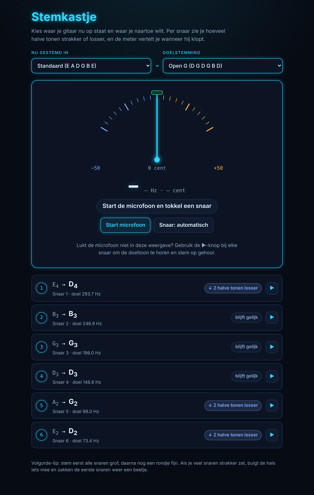
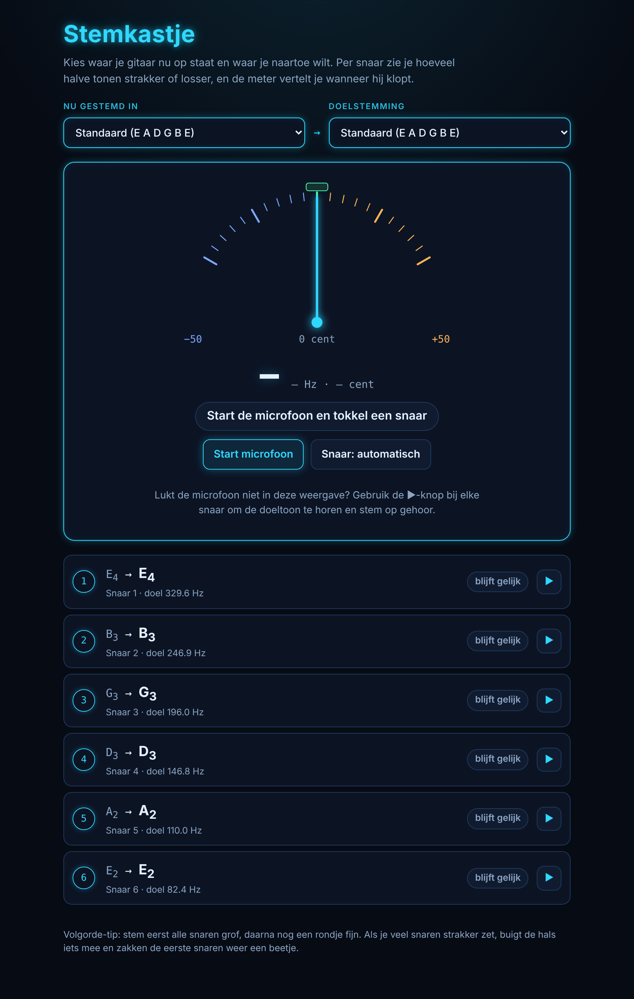
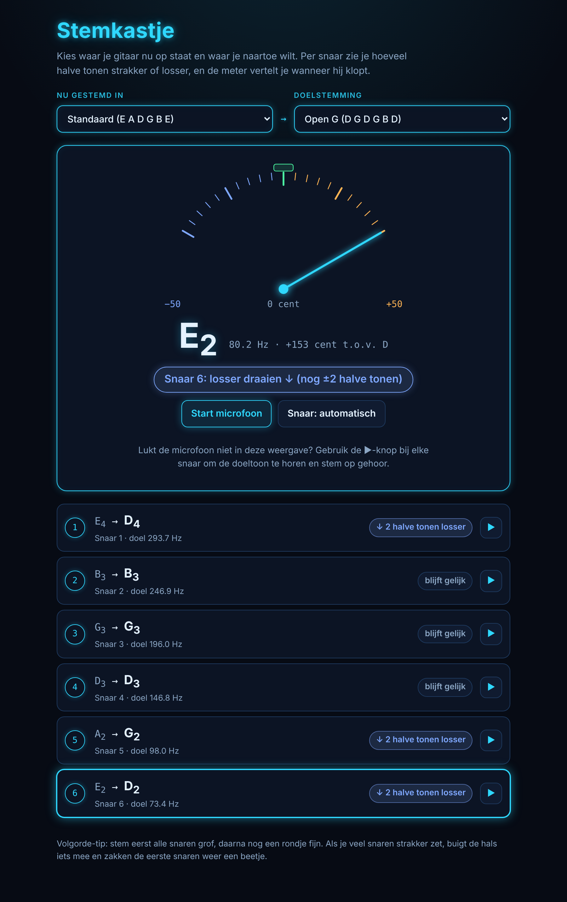
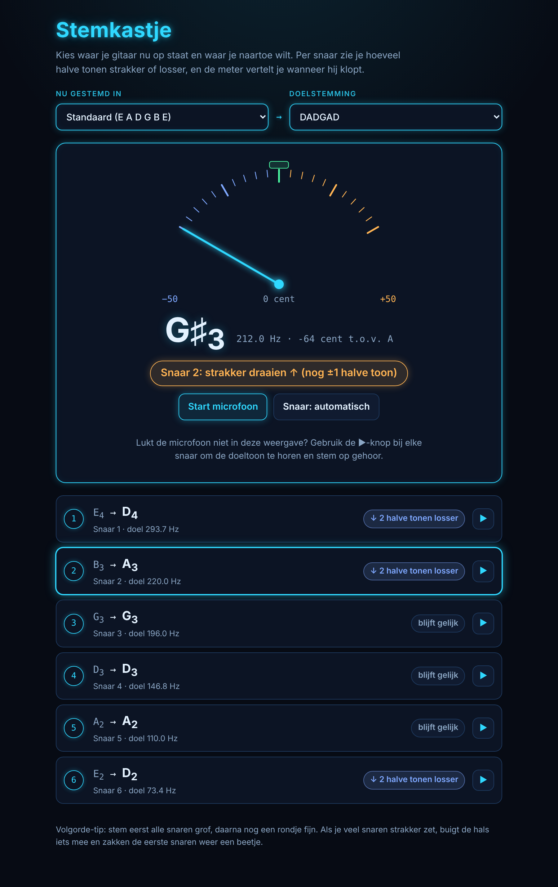
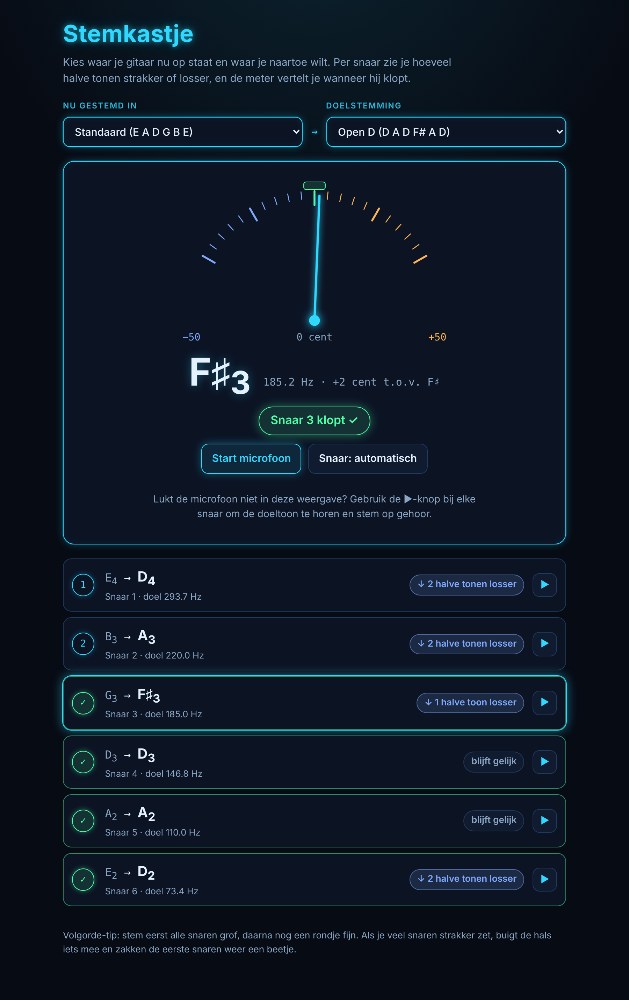
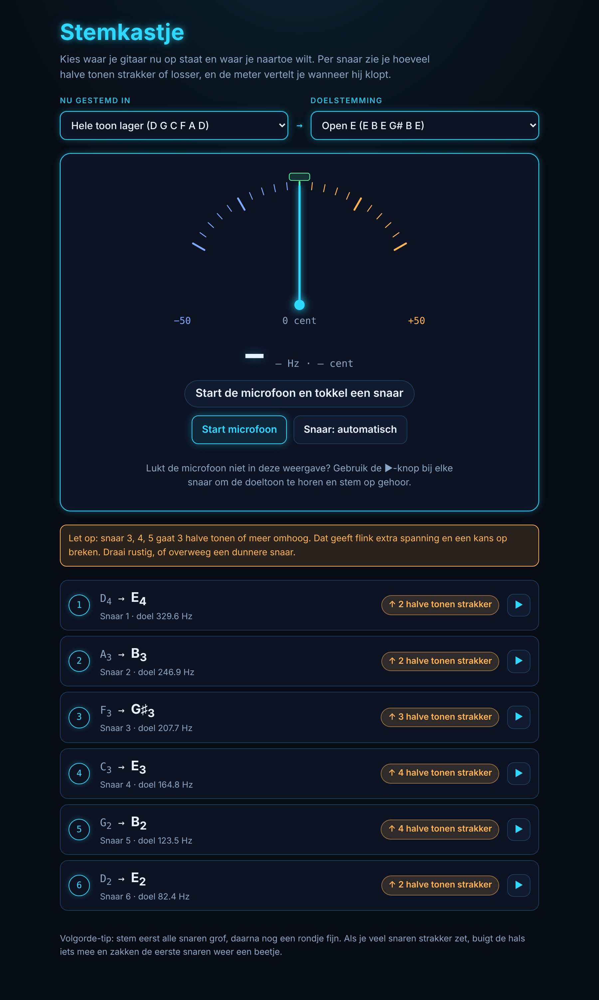
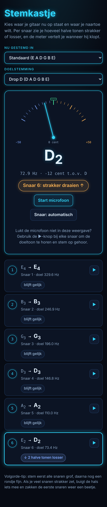

# 🎸 Gitaar-stemkastje

Een gitaartuner die je van de ene stemming naar de andere brengt. Kies waar je gitaar nu op staat en waar je naartoe wilt, bijvoorbeeld standaard → open G. Per snaar zie je hoeveel halve tonen hij strakker of losser moet. Via de microfoon laat de meter zien wanneer elke snaar klopt.

**▶ Direct gebruiken:** https://endless1977.github.io/Gitaar-stemkastje/
**💾 Windows-versie:** [`download/Stemkastje.exe`](download/Stemkastje.exe)



## Wat het doet

- **Stemming naar stemming:** je kiest je huidige stemming en je doelstemming. Per snaar zie je de oude en nieuwe toon, de doelfrequentie en een label als *↑ 2 halve tonen strakker* of *↓ 1 halve toon losser*.
- **Live meter:** de microfoon luistert mee en de naald laat de afwijking in cents zien (−50 tot +50). Een balk vertelt je of je strakker of losser moet draaien, en hoeveel halve tonen je er ongeveer nog naast zit.
- **Automatische snaarherkenning:** de tuner kiest zelf de snaar die het dichtst bij de gespeelde toon ligt. Klik op een snaar om hem vast te zetten.
- **Vinkjes:** een snaar die even zuiver blijft klinken, krijgt een groen vinkje. Zo zie je wat je al gehad hebt.
- **Referentietoon:** met ▶ hoor je de doeltoon van elke snaar. Handig als je op gehoor wilt stemmen.
- **Waarschuwing bij veel spanning:** gaat een snaar 3 halve tonen of meer omhoog, dan krijg je een melding, want de kans dat hij breekt wordt dan groter.
- **Werkt op telefoon en desktop.**

## Stemmingen

| Stemming | Snaren (6 → 1) |
|---|---|
| Standaard | E A D G B E |
| Open G | D G D G B D |
| Open D | D A D F♯ A D |
| Open E | E B E G♯ B E |
| Open A | E A E A C♯ E |
| Open C | C G C G C E |
| Open D mineur | D A D F A D |
| Drop D | D A D G B E |
| Drop C | C G C F A D |
| DADGAD | D A D G A D |
| Halve toon lager | E♭ A♭ D♭ G♭ B♭ E♭ |
| Hele toon lager | D G C F A D |

## Screenshots

| | |
|---|---|
|  |  |
| **Startscherm:** beide keuzes beginnen op Standaard. | **Te hoog:** de naald slaat rechts uit, dus losser draaien. |
|  |  |
| **Te laag:** de naald slaat links uit, dus strakker draaien. | **Klopt:** groene melding, en de gestemde snaren hebben een vinkje. |
|  |  |
| **Waarschuwing:** van hele toon lager naar open E gaan drie snaren flink omhoog. | **Mobiel:** dezelfde tuner op een telefoon. |

## Gebruik

1. Open de [online versie](https://endless1977.github.io/Gitaar-stemkastje/) of start `Stemkastje.exe`.
2. Kies **Nu gestemd in** en **Doelstemming**.
3. Klik **Start microfoon** en sta de microfoon toe.
4. Tokkel één snaar tegelijk en laat hem uitklinken. Draai tot de naald in het groene vak staat.
5. Tip: stem eerst alle snaren grof en doe daarna nog een fijn rondje. Als je veel snaren strakker zet, buigt de hals iets mee en zakken de eerste snaren weer een beetje.

## Windows-programma

`Stemkastje.exe` is een kleine launcher, geschreven in Go (`main.go`). Hij serveert de pagina lokaal en opent hem in je standaardbrowser, zodat de microfoon gewoon werkt. Als je het tabblad sluit, stopt het programma vanzelf.

Bij de eerste start kan Windows SmartScreen waarschuwen, omdat de exe niet digitaal ondertekend is. Kies dan *Meer informatie* → *Toch uitvoeren*.

Zelf bouwen:

```
GOOS=windows GOARCH=amd64 go build -ldflags "-s -w -H windowsgui" -o Stemkastje.exe .
```

## Techniek

- Eén HTML-bestand (`index.html`) zonder frameworks. Het gebruikt alleen Google Fonts, en zonder internet vallen de letters terug op systeemfonts.
- De toonhoogte wordt herkend met autocorrelatie via de Web Audio API, met een mediaanfilter tegen gespring.
- De referentietonen worden in de browser zelf gemaakt met oscillators.

---

Gemaakt door Endless (Joris Zuijdervliet).
